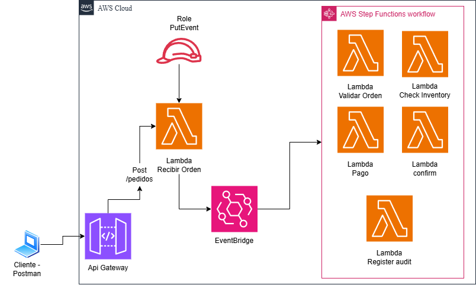

# Sistema de Procesamiento de Pedidos

Laboratorio que implementa una arquitectura para recibir y procesar pedidos usando API Gateway, Lambda, EventBridge y Step Functions.

---

## 1. Descripción

Un cliente envía un pedido mediante una petición `POST /pedidos`. El sistema lo recibe, publica un evento y ejecuta un flujo automático que **valida la orden, revisa el inventario, procesa el pago, confirma el pedido y registra una auditoría**.

---

## 2. Arquitectura



### Flujo paso a paso

1. El **cliente (Postman)** envía `POST /pedidos` con los datos de la orden.
2. **API Gateway** recibe la petición y la enruta a la Lambda `Recibir Orden`.
3. La Lambda **Recibir Orden** valida lo básico y publica el evento `OrdenCreada` en EventBridge (usando el rol con permiso `events:PutEvents`).
4. **EventBridge** evalúa la regla y dispara la ejecución de la **máquina de estados** de Step Functions.
5. **Step Functions** ejecuta en orden las Lambdas: Validar Orden → Check Inventory → Pago → Confirm → Register Audit.

---

## 3. Servicios utilizados

| Servicio | Función en la solución |
|---|---|
| **API Gateway** | Punto de entrada HTTP (`POST /pedidos`) |
| **AWS Lambda** | Ejecuta la lógica de cada paso |
| **IAM Role (PutEvent)** | Permite a la Lambda publicar en EventBridge |
| **Amazon EventBridge** | Recibe el evento y lo envía a Step Functions |
| **AWS Step Functions** | Orquesta el flujo de validación, inventario, pago, confirmación y auditoría |

### Funciones Lambda

| Lambda | Responsabilidad |
|---|---|
| `RecibirOrden` | Recibe el pedido desde API Gateway y publica el evento en EventBridge |
| `ValidarOrden` | Verifica que los datos del pedido estén completos y sean válidos |
| `CheckInventory` | Confirma que hay existencias suficientes |
| `Pago` | Procesa el cobro |
| `Confirm` | Marca la orden como confirmada |
| `RegisterAudit` | Registra un historial de lo ocurrido para trazabilidad |

---

## 4. Cómo usar la solución

### Endpoint

```
POST https://cvi1ksbgo7.execute-api.us-east-1.amazonaws.com/pedidos
```

### Headers

```
Content-Type: application/json
```

### Ejemplo de petición (body)

```json
{
  "cliente": "sebas",
  "producto": "Laptop",
  "cantidad": 5,
  "total": 2000
}
